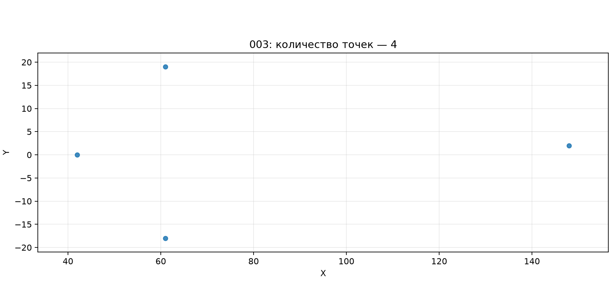
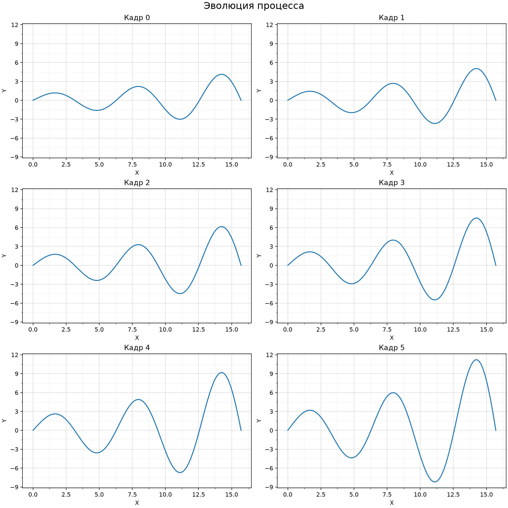
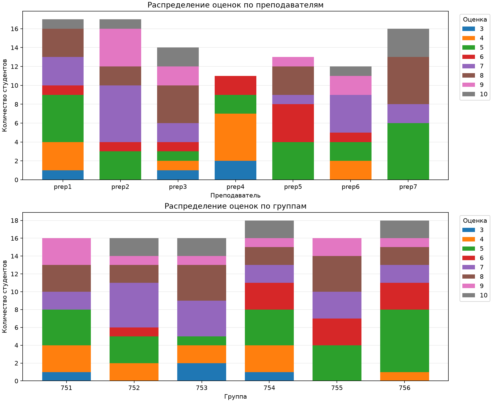

# Лабораторная по Matplotlib

Решены три эпизода задания. Код написан без комментариев.

## Запуск

Требуется Python 3.10 или новее. Из корня репозитория:

```sh
python -m pip install -r matplotlib_lab/requirements.txt
python matplotlib_lab/main.py
```

Графики сохраняются в папку `matplotlib_lab/results`. Пути к данным определяются относительно файлов программы, поэтому запуск не зависит от текущей рабочей папки. Доступ к интернету при запуске не нужен.

Каждый эпизод можно запустить отдельно:

```sh
python matplotlib_lab/episode1.py
python matplotlib_lab/episode2.py
python matplotlib_lab/episode3.py
```

## Эпизод 1

Из каждого файла `data/episode1/*.dat` считываются число точек и следующие за ним пары координат. Остальные строки файла не используются, как указано в условии. Для каждого из пяти наборов строится отдельный график с названием файла, количеством точек и одинаковым масштабом по X и Y. Результаты: `results/episode1/001.png` — `005.png`.



Для набора 005 дополнительно сохраняется `005_details.png`: близкие точки объединяются в группы по расстоянию, и каждая группа показывается крупнее с одинаковым масштабом по X и Y. Общий рисунок сохраняет геометрию всего набора.

## Эпизод 2

Из `data/episode2/frames.dat` считываются пары строк с координатами X и Y. Для всех шести кадров используются общие пределы осей и одинаковая координатная сетка. Кадры пронумерованы от 0 до 5. Результаты: отдельные изображения `results/episode2/frame_000.png` — `frame_005.png` и общий рисунок `all_frames.png`.



## Эпизод 3

Файл `data/episode3/students.csv` содержит 100 записей в формате `преподаватель;группа;оценка`. Строятся две составные столбчатые диаграммы: распределение оценок по преподавателям и по группам. Одинаковые оценки обозначены одинаковыми цветами на обоих графиках. Высота каждого столбца равна количеству студентов соответствующей категории.



Дополнительное задание: в `results/episode3/conclusions.txt` сохраняются средние оценки и численность каждой категории. По этим данным наиболее лояльным можно предположительно считать `prep2` (7,35), наиболее строгим — `prep4` (4,36). Минимальная средняя оценка у группы `754` (6,22). Это предположения: распределение студентов между преподавателями может влиять на результат, а низкая средняя оценка сама по себе не доказывает небрежность студентов.

## Материалы

При подготовке использованы все семь вводных примеров из [учебного репозитория TheEntityCircle/python-3rd-term, 2021/05](https://github.com/TheEntityCircle/python-3rd-term/tree/master/2021/05): построение графиков, объектный интерфейс, подписи и легенды, несколько графиков на рисунке, оформление, столбчатые диаграммы и сохранение изображений.

Условия взяты из предоставленных скриншотов «Лабораторная по mpl». Все данные предоставлены вместе с заданием: архив `dead_moroz.zip`, файл `students.csv` и файл `frames.dat.txt`, сохранённый в проекте как `frames.dat`. [Исходная ссылка на файл кадров в LMS МФТИ](https://lms.mipt.ru/pluginfile.php/300121/mod_assign/intro/frames.dat).
